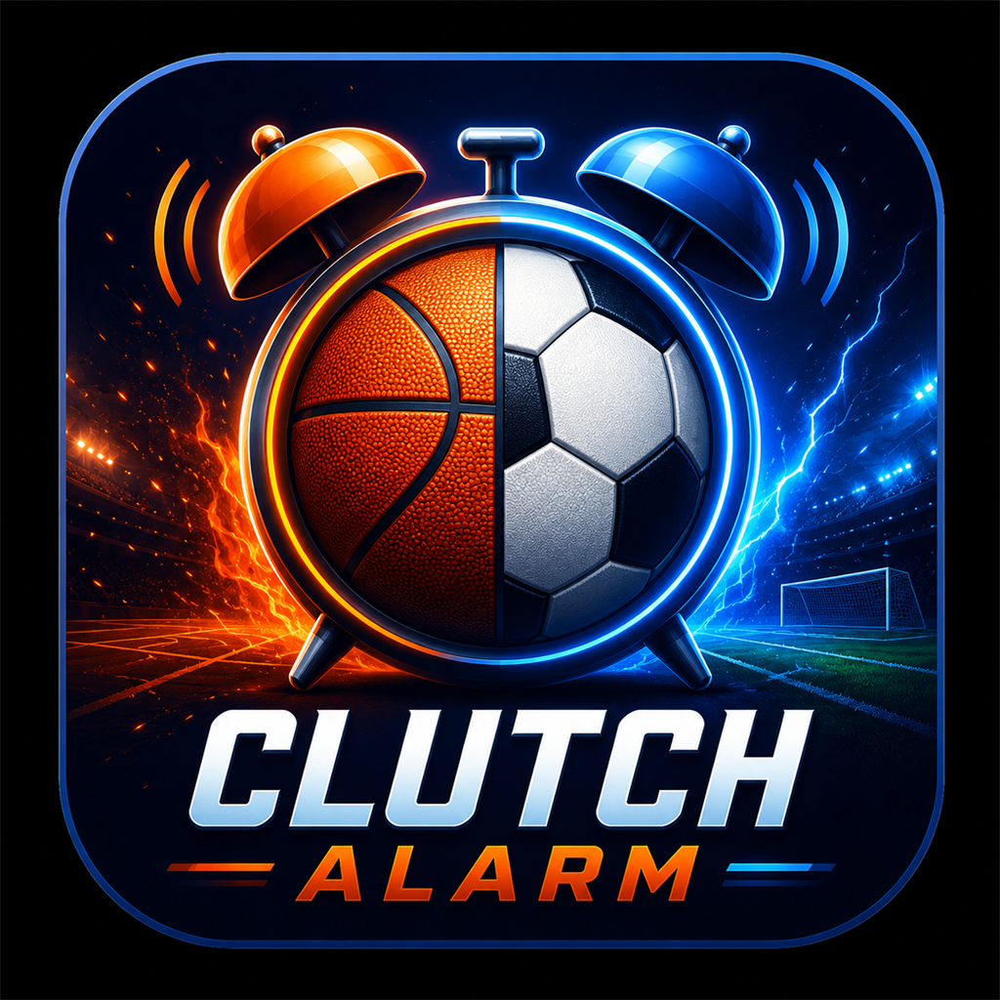

# 🏀 Clutch Alarm

> **An alarm clock for NBA fans.** Fall asleep and let the app wake you up when it matters.

<p align="center">
  <a href="https://clutchalarm.com">
    
  </a>
</p>

<p align="center">
  <a href="https://clutchalarm.com">🌐 Website</a> •
  <a href="https://clutchalarm.com/privacy">🔒 Privacy Policy</a> •
  <a href="mailto:feedback@clutchalarm.com">📬 Contact</a>
</p>

---

## 💡 The Idea

Late-night NBA games shouldn't mean staying up all night. **Clutch Alarm** monitors every game in real-time and wakes you up **only** when something worth watching is happening — a close game, a player going off, or a historic stat line unfolding.

If nothing happens? You sleep through undisturbed. 😴

## ✨ Features

| Feature | Description |
|---------|-------------|
| 🔔 **Game Alarms** | Set a score gap threshold + starting quarter. The alarm fires when the game gets close — even if your phone is on silent.* |
| 👤 **Player Alarms** | Track individual players: Points Goal, Early Scorer, Triple-Double Watch. Each condition fires independently. |
| ⭐ **Favorites** | Save teams & players with custom thresholds. The app monitors every game they play, automatically. |
| 📡 **Global Radar** | Scans the entire league every night. Any close game triggers an alert — no manual setup needed. |
| 🏆 **Historical Mode** | Get alerted for rare stat lines: 40+ points by halftime, 12+ three-pointers, quad-double threats. |
| 📺 **TV Broadcast Guide** | See which channels carry each game. "Broadcast Only" option — only alert when the game is on TV. |
| 🔊 **Alarm Sounds** | 6 built-in sounds that bypass silent mode and Do Not Disturb.* |
| 🌍 **Bilingual** | Full English + Hebrew (עברית) support with RTL layout. |

> \* *Silent mode & DND bypass, full-screen alerts, and screen wake are Android-only features.*

## 🏗️ Architecture

```
┌──────────────────┐     ┌──────────────────┐     ┌──────────────┐
│   Mobile Apps    │────▶│  FastAPI Server   │────▶│  ESPN APIs   │
│  Android (Expo)  │◀────│   (Python)        │     │  (Live Data) │
│  iOS (SwiftUI)   │     │                   │     └──────────────┘
└──────────────────┘     │  ┌─────────────┐  │
        ▲                │  │  PostgreSQL  │  │
        │                │  └─────────────┘  │
   Push Notifications    │  ┌─────────────┐  │
   (Firebase FCM)        │  │  Firebase    │  │
                         │  │  Admin SDK   │  │
                         │  └─────────────┘  │
                         └──────────────────┘
```

**Monorepo with three components:**

| Component | Path | Stack |
|-----------|------|-------|
| 🤖 Android App | `mobile/` | Expo / React Native / TypeScript |
| 🍎 iOS App | [Separate repo](https://github.com/ItamarKenan/NBA-Smart-Alarm) | SwiftUI / Swift |
| ⚙️ Server | `server/` | FastAPI / SQLAlchemy / Python |
| 🌐 Website | `website/` | Static HTML/CSS/JS on Cloudflare Pages |

### Notification Flow

```
Server polls ESPN → dedup check (_fire_once) → FCM data-only message
→ Mobile receives → Notifee/UNNotification on STREAM_ALARM channel
→ Bypasses silent mode → Full-screen intent + screen wake
```

### Three Monitoring Modes

1. **Manual Game Alarm** — one thread per alarm, watches score differential
2. **Manual Player Alarm** — one thread per alarm, watches player stats
3. **Radar** — single continuous thread, checks all users' favorites against all live games

## 🚀 Quick Start

### Server

```bash
cd server
pip install -r requirements.txt
python -m uvicorn main:app --reload --host 0.0.0.0 --port 8001
```

### Android App

```bash
cd mobile
npm install
npm start
```

### Website

```bash
cd website
npx wrangler pages deploy . --project-name clutch-alarm --branch main
```

## 🔧 Environment

| Service | Purpose |
|---------|---------|
| **Railway** | Server hosting + PostgreSQL |
| **Firebase** | Push notifications (FCM) |
| **Cloudflare Pages** | Website hosting ([clutchalarm.com](https://clutchalarm.com)) |
| **EAS** | Android builds (Expo Application Services) |

## 🗄️ Database

| Table | Purpose |
|-------|---------|
| `alarms` | One-shot game/player alarms (deactivated after firing) |
| `favorites` | Persistent favorite players with stat thresholds |
| `favorite_teams` | Persistent favorite teams with score gap thresholds |
| `user_preferences` | Global radar config per user |
| `fired_alerts` | Dedup log (survives server restarts) |

## 👥 Team

| | Role |
|---|------|
| **Nadav Keshet** | Creator, Android app, server |
| **Itamar Kenan** | iOS app |

## 📄 Legal

Not affiliated with, endorsed by, or connected to the National Basketball Association (NBA) or any of its teams. All NBA-related names and marks are the property of their respective owners.

---

<p align="center">
  <b>Clutch Alarm</b> © 2025 — <a href="https://clutchalarm.com">clutchalarm.com</a>
</p>
